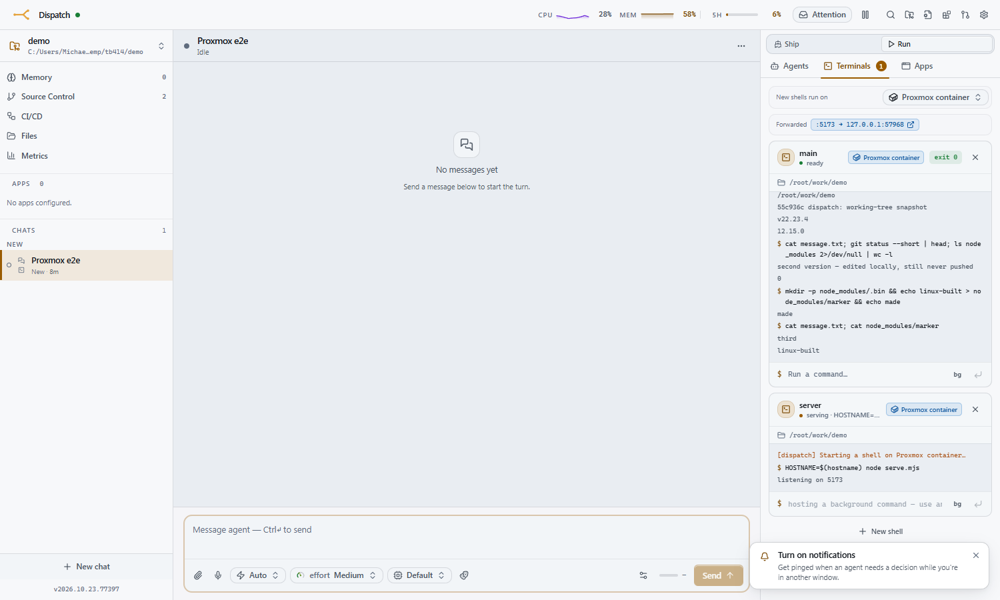

# dispatch-proxmox-terminal

A [Dispatch](https://github.com/mdennis281/dispatch) plugin that runs each chat's **managed terminals** (the agent's `terminal` tool and the Terminals panel) in **its own Proxmox LXC**, instead of on the machine Dispatch runs on.

- **One container per chat.** It is linked-cloned from a template the first time the chat opens a terminal, stopped when the chat goes idle, started again on the next command, and destroyed when the chat is deleted.
- **The container has its own git checkout.** Before every command, the plugin snapshots the chat's *local* worktree (committed, uncommitted and untracked files alike, ignored files excluded) and checks it out on the container. The agent keeps editing locally; nothing is pushed to GitHub to test a change, and **no GitHub token ever goes onto the container**.
- **Installs and build output stay on the container.** `node_modules`, `dist` and the rest of the ignored files are never synced, so the container keeps its own Linux-built copies between commands. A Windows-built `node_modules` would be useless there anyway. Losing a container loses only those; the real copy of the code is on the Dispatch host.
- **Servers are forwarded.** Anything that listens on a port of 1024 or above in the container gets a `http://127.0.0.1:<port>` on the Dispatch host. It shows up in the terminal tool's results and in the Terminals panel, so a browser (or the agent's Playwright) can open it.
- **Failure is loud.** If Proxmox is unreachable or provisioning times out, Dispatch brings the shell up locally and says why, in the terminal, the chat, and the agent's next tool result.



It is optional: Dispatch without this plugin behaves exactly as it always has. Which chats use it is your choice. Set a project default (Project settings → Chat defaults → *Terminals run on*) and override it per chat (Terminals panel → *New shells run on*).

Requires a Dispatch that has terminal backends (#414/#415, the `terminals` plugin capability).

---

## 1. Build the template

Every container is a **linked clone** of one LXC template. That is fast (seconds, on ZFS or LVM-thin), and it means what's installed in the template is what every chat gets. The template needs `bash`, `git`, `openssh-server`, a C toolchain for native npm modules, and Node + pnpm.

On the Proxmox host (adjust the vmid, storage and the Debian template version you have):

```bash
# a key pair the plugin will use to reach the containers (on the DISPATCH host):
#   ssh-keygen -t ed25519 -N "" -C dispatch-proxmox-terminal -f ~/.ssh/dispatch_proxmox_terminal
# then copy the .pub to the Proxmox host as /root/dispatch_proxmox_terminal.pub

pct create 9000 local:vztmpl/debian-12-standard_12.7-1_amd64.tar.zst \
  --hostname dispatch-term-tpl --unprivileged 1 --features nesting=1 \
  --rootfs rpool:16 --cores 2 --memory 4096 --swap 512 \
  --net0 name=eth0,bridge=vmbr0,ip=dhcp,type=veth \
  --ssh-public-keys /root/dispatch_proxmox_terminal.pub \
  --pool dispatch-terminals --tags dispatch-terminal
pct start 9000
pct exec 9000 -- bash -c '
  set -e; export DEBIAN_FRONTEND=noninteractive
  apt-get update -qq
  apt-get install -y -qq git bash build-essential curl ca-certificates openssh-server python3
  curl -fsSL https://deb.nodesource.com/setup_22.x | bash -
  apt-get install -y -qq nodejs
  corepack enable && corepack prepare pnpm@latest --activate
  git config --system safe.directory "*"
  mkdir -p /root/work
  apt-get clean; rm -rf /var/lib/apt/lists/*
  truncate -s 0 /etc/machine-id   # so clones do not share a DHCP identity
'
pct shutdown 9000
pct template 9000
```

Prefer a password? Pass `--password` to `pct create` (or run `passwd` inside before converting) and store it as the `PROXMOX_TERMINAL_SSH_PASSWORD` secret. Key and password can be used together.

## 2. A least-privilege API token

The plugin needs to clone, configure, start, stop and destroy containers in **one resource pool**, and nothing else.

```bash
pveum pool add dispatch-terminals --comment "Dispatch per-chat terminals"
pveum role add DispatchTerminal --privs "VM.Allocate,VM.Clone,VM.Audit,VM.PowerMgmt,VM.Config.Options,VM.Config.Network,VM.Config.CPU,VM.Config.Memory,VM.Config.Disk,Datastore.AllocateSpace,Datastore.Audit,SDN.Use"
pveum user add dispatch-terminal@pve --comment "Dispatch proxmox-terminal plugin"
pveum acl modify /pool/dispatch-terminals      --users dispatch-terminal@pve --roles DispatchTerminal
pveum acl modify /storage/rpool                --users dispatch-terminal@pve --roles DispatchTerminal   # the template's storage
pveum acl modify /sdn/zones/localnetwork       --users dispatch-terminal@pve --roles DispatchTerminal   # bridges (PVE 8)
pveum user token add dispatch-terminal@pve dispatch --privsep 0
```

Put the template in the pool (`--pool dispatch-terminals` above, or `pveum pool modify dispatch-terminals --vms 9000`) so the token may clone it. The token's value is printed once.

| privilege | why |
|---|---|
| `VM.Clone` | linked-clone the template |
| `VM.Allocate` | create the clone (in the pool) and destroy it when the chat is deleted |
| `VM.Config.*` | set cores, memory and the network on the clone |
| `VM.PowerMgmt` | start it, stop it when idle |
| `VM.Audit` | read its status and its DHCP address |
| `Datastore.AllocateSpace` / `Datastore.Audit` | the clone's disk on the template's storage |
| `SDN.Use` | attach the clone to the bridge (Proxmox 8 checks this) |

## 3. Install the plugin

In Dispatch: **Settings → Plugins → Install from URL**, paste

```
https://github.com/mdennis281/dispatch-proxmox-terminal
```

review what it asks for, and install. Or from a shell: `dispatch plugin add https://github.com/mdennis281/dispatch-proxmox-terminal`.

Then:

1. **Secrets** (Settings → Secrets, global):
   - `PROXMOX_TERMINAL_API_TOKEN`: `dispatch-terminal@pve!dispatch=<the token's secret>`
   - optionally `PROXMOX_TERMINAL_SSH_KEY` (the private key's text) and/or `PROXMOX_TERMINAL_SSH_PASSWORD`
2. **Settings** (Settings → Plugins → Proxmox terminal):
   - **Proxmox API URL**: e.g. `https://10.0.0.20:8006`
   - **Node**, **Template vmid**, **Resource pool**, **Network bridge**, **Cores** and **Memory**
   - **First/last vmid**: the range clones are allocated from (default 9001–9099)
   - **SSH private key file**: e.g. `~/.ssh/dispatch_proxmox_terminal`, if you didn't use the secret
   - **Stop after idle (minutes)**: 30 by default; 0 stops at once, -1 never
   - **Destroy after unused (days)**: 7 by default; a container no terminal has used for this long is destroyed even if its chat still exists (0 keeps it until the chat is deleted)
   - **Proxmox CA certificate**: paste `/etc/pve/pve-root-ca.pem` so the node's self-signed certificate is verified properly (or, worse, tick *Skip TLS verification*)
3. Pick which chats use it: a project default under Project settings → Chat defaults → **Terminals run on**, or per chat in its Terminals panel.

## Cleanup

Containers must not outlive their purpose just because Dispatch restarted, crashed, or Proxmox was down at the wrong moment. Everything below is kept in the plugin's kv store, and a sweep (at load, then every minute) acts on what is due:

- **Idle stop survives restarts.** The idle deadline is stored, not just held in a timer. A container whose deadline passed while Dispatch was down is stopped on the next load. One whose chat was busy when Dispatch crashed is stopped at once; a clean shutdown writes a deadline first, so a restart keeps it for reuse.
- **Destroys are retried.** A destroy is recorded before it is tried, and retried with backoff (30 s, doubling to 30 min) until it succeeds, across restarts.
- **Only its own containers.** Each clone's description names its chat and this Dispatch instance. The plugin only stops or destroys a vmid inside the configured range that is not a template and whose description still names the chat. Two Dispatch instances sharing one pool (stable and dev) never touch each other's clones.
- **On a Dispatch with the cleanup lifecycle** (`reconcile` / `onShutdown`): at startup, clones of chats that no longer exist are destroyed. On restart, containers are left running. On stop or disable, they are shut down (not destroyed). On uninstall, every clone this instance made is destroyed. Older Dispatch versions don't call these hooks; everything above still works.
- **Switch the plugin on before uninstalling it.** Dispatch can't run a switched-off plugin's uninstall hook, so its clones would be left behind. If that already happened, the leftovers are the pool's members whose description says `proxmox-terminal plugin`; destroy them by hand.

## How the sync works

```
local worktree ──(temp GIT_INDEX_FILE: add -A, write-tree, commit-tree -p HEAD)──▶ snapshot commit
snapshot ──(git pack-objects --revs  snapshot ^<commits the container has>)──▶ ssh exec: git index-pack --stdin
container: git update-ref refs/dispatch/snapshot <sha> && git checkout --force --detach <sha>
```

- The real index, stash, branches and HEAD are never touched. The temp index starts as a copy of the real one, so `add -A` is fast.
- Commit dates are pinned, so an unchanged worktree is the same commit and a sync is a no-op.
- The first sync seeds the checkout. When `origin` is a public GitHub repo it starts from a shallow clone of it, so the first pack is just your local delta; otherwise it starts from an empty repo, and the first pack carries the history.
- The checkout on the container is detached at the snapshot. Don't commit there: git work belongs on the Dispatch host, where your credentials are.

## Develop

The SDK is not on npm. It is `link:`ed from a Dispatch checkout beside this one, at `../claude-manager/packages/plugin-sdk`; edit that path in `package.json` if yours lives elsewhere.

```bash
git clone https://github.com/mdennis281/dispatch claude-manager
cd claude-manager && pnpm install && pnpm --filter @dispatch/shared --filter @dispatch/plugin-sdk build && cd ..
git clone https://github.com/mdennis281/dispatch-proxmox-terminal && cd dispatch-proxmox-terminal
pnpm install && pnpm test && pnpm build                 # build → server/index.js, which is COMMITTED
```

`server/index.js` is committed on purpose: the URL installer copies the repository as-is and never builds, and the update check compares commits. Rebuild and commit it with every source change. `ssh2`'s optional native addons are left out of the bundle (see `vite.server.config.mjs`), so it runs on ssh2's pure-JS crypto.

## License

MIT
