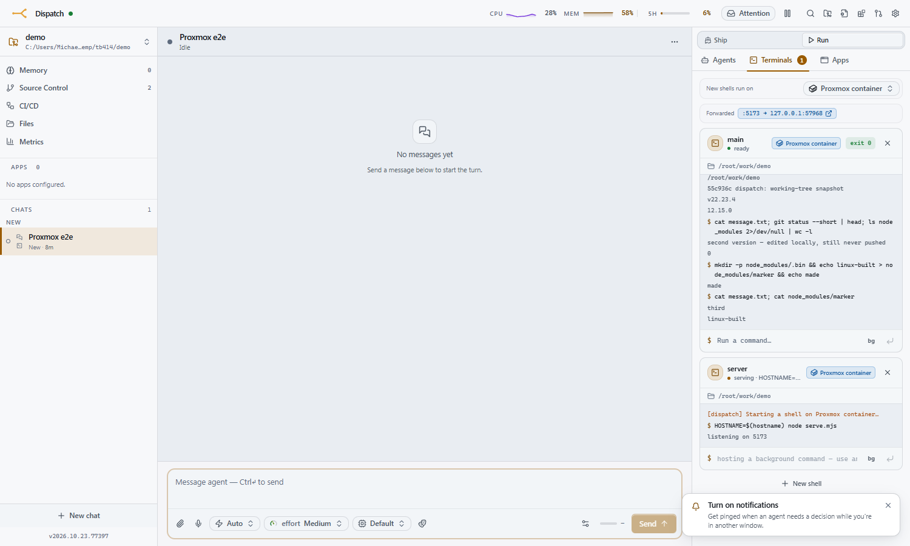

# Proxmox terminal (`proxmox-terminal`)

A [Dispatch](https://github.com/mdennis281/dispatch) plugin, part of [dispatch-plugins](https://github.com/mdennis281/dispatch-plugins), that runs each chat's **managed terminals** (the agent's `terminal` tool and the Terminals panel) in **its own Proxmox LXC**, instead of on the machine Dispatch runs on.

- **One container per chat.** It is linked-cloned from a template the first time the chat opens a terminal, stopped when the chat goes idle, started again on the next command, and destroyed when the chat is deleted.
- **What runs on it is [Remote host](../remote-host/README.md)'s.** Since 0.2 this plugin owns the containers (clone, start, stop, destroy) and hands each one to remote-host, which runs the chat's shells there under dispatch-host, syncs the chat's worktree both ways around every command, forwards the dev servers it starts, and runs the chat's browser MCP servers there. See remote-host's [Machines for other plugins](../remote-host/README.md#machines-for-other-plugins).
- **The agent keeps editing locally.** Before each command your worktree (committed, uncommitted and untracked files alike, ignored files excluded) goes to the container; what the command changed there comes back after it. Nothing is pushed to GitHub to test a change, and **no GitHub token ever goes onto the container**.
- **Installs and build output stay on the container.** Ignored files (`node_modules`, `dist`…) are never synced, so the container keeps its own Linux-built copies between commands. Losing a container loses only those.
- **Failure is loud, and never local.** If Proxmox or remote-host is missing, unreachable or too old, Dispatch refuses the terminal and says why, in the chat and the agent's tool result. It never falls back to a local shell, which would run the command against the wrong tree. Retry once the container can come up, or switch the chat's terminal location back to local yourself.



It is optional: Dispatch without this plugin behaves exactly as it always has. Which chats use it is your choice. Set a project default (Project settings → Chat defaults → *Terminals run on*) and override it per chat (Terminals panel → *New shells run on*).

**Requires** a Dispatch with plugin dependencies (`ctx.dependencies`) and **Remote host 0.11.0 or newer** installed and switched on, from the same collection. Installing this plugin offers remote-host with it. Without either, the plugin still manages its containers (idle stops, destroys, uninstall) but refuses every terminal, and its status says why.

---

## 1. Build the template

Every container is a **linked clone** of one LXC template. That is fast (seconds, on ZFS or LVM-thin), and it means what's installed in the template is what every chat gets. The template needs `bash`, `git` (2.26 or newer), `openssh-server` and `iproute2` (remote-host's needs, see its [Linux machines](../remote-host/README.md#linux-machines)), plus what your projects build with: a C toolchain for native npm modules, and Node + pnpm. A 64-bit glibc distribution (Debian, Ubuntu); not Alpine.

On the Proxmox host (adjust the vmid, storage and the Debian template version you have):

```bash
# a key pair the plugin will use to reach the containers (on the DISPATCH host):
#   ssh-keygen -t ed25519 -N "" -C dispatch-proxmox-terminal -f ~/.ssh/dispatch_proxmox_terminal
# then copy the .pub to the Proxmox host as /root/dispatch_proxmox_terminal.pub

pct create 9000 local:vztmpl/debian-12-standard_12.7-1_amd64.tar.zst \
  --hostname dispatch-term-tpl --unprivileged 1 --features nesting=1 \
  --rootfs rpool:16 --cores 2 --memory 4096 --swap 512 \
  --net0 name=eth0,bridge=vmbr0,ip=dhcp,type=veth \
  --ssh-public-keys /root/dispatch_proxmox_terminal.pub \
  --pool dispatch-terminals --tags dispatch-terminal
pct start 9000
pct exec 9000 -- bash -c '
  set -e; export DEBIAN_FRONTEND=noninteractive
  apt-get update -qq
  apt-get install -y -qq git bash build-essential curl ca-certificates openssh-server python3 iproute2 procps
  curl -fsSL https://deb.nodesource.com/setup_22.x | bash -
  apt-get install -y -qq nodejs
  corepack enable && corepack prepare pnpm@latest --activate
  git config --system safe.directory "*"
  mkdir -p /root/work
  apt-get clean; rm -rf /var/lib/apt/lists/*
  truncate -s 0 /etc/machine-id   # so clones do not share a DHCP identity
'
pct shutdown 9000
pct template 9000
```

Prefer a password? Pass `--password` to `pct create` (or run `passwd` inside before converting) and store it as the `PROXMOX_TERMINAL_SSH_PASSWORD` secret. Key and password can be used together, but remote-host sends a password only to a container whose host key is pinned (`templateHostKey`, below).

**Pin the template's host key.** Every clone keeps the template's SSH host key, so one fingerprint identifies them all. Read it before converting, and put it in the `templateHostKey` setting:

```bash
pct exec 9000 -- ssh-keygen -lf /etc/ssh/ssh_host_ed25519_key.pub   # 256 SHA256:… root@… (ED25519)
```

Left blank, a container is trusted because the Proxmox API gave its address, and the Settings pane warns about it. Either way remote-host also writes a token on each container at its first connect and checks it on every later one, so a container at another chat's old address is refused.

**Optional, faster first commands.** On a container's first connect remote-host installs its own Node runtime (about 50 MB) and dispatch-host under `/root/.dispatch-host`, and a chat's first browser use installs Chromium's system libraries with apt. Both can be baked into the template instead: install them in a container made from it, then make *that* the template (never change a template that has linked clones). Leave out `/root/.dispatch-host/incarnation` and the per-instance directories; only `runtime/` and `agent/` belong in a template.

## 2. A least-privilege API token

The plugin needs to clone, configure, start, stop and destroy containers in **one resource pool**, and nothing else.

```bash
pveum pool add dispatch-terminals --comment "Dispatch per-chat terminals"
pveum role add DispatchTerminal --privs "VM.Allocate,VM.Clone,VM.Audit,VM.PowerMgmt,VM.Config.Options,VM.Config.Network,VM.Config.CPU,VM.Config.Memory,VM.Config.Disk,Datastore.AllocateSpace,Datastore.Audit,SDN.Use"
pveum user add dispatch-terminal@pve --comment "Dispatch proxmox-terminal plugin"
pveum acl modify /pool/dispatch-terminals      --users dispatch-terminal@pve --roles DispatchTerminal
pveum acl modify /storage/rpool                --users dispatch-terminal@pve --roles DispatchTerminal   # the template's storage
pveum acl modify /sdn/zones/localnetwork       --users dispatch-terminal@pve --roles DispatchTerminal   # bridges (PVE 8)
pveum user token add dispatch-terminal@pve dispatch --privsep 0
```

Put the template in the pool (`--pool dispatch-terminals` above, or `pveum pool modify dispatch-terminals --vms 9000`) so the token may clone it. The token's value is printed once.

| privilege | why |
|---|---|
| `VM.Clone` | linked-clone the template |
| `VM.Allocate` | create the clone (in the pool) and destroy it when the chat is deleted |
| `VM.Config.*` | set cores, memory and the network on the clone |
| `VM.PowerMgmt` | start it, stop it when idle |
| `VM.Audit` | read its status and its DHCP address |
| `Datastore.AllocateSpace` / `Datastore.Audit` | the clone's disk on the template's storage |
| `SDN.Use` | attach the clone to the bridge (Proxmox 8 checks this) |

## 3. Install the plugin

In Dispatch: **Settings → Plugins → Inspect from URL**, paste

```
https://github.com/mdennis281/dispatch-plugins
```

tick **Proxmox terminal** in the list, review what it asks for, and install. This plugin's own URL, `https://github.com/mdennis281/dispatch-plugins/tree/main/plugins/proxmox-terminal`, goes straight to its report. Or from a shell: `dispatch plugin add https://github.com/mdennis281/dispatch-plugins --plugin proxmox-terminal`.

Installed from the old `dispatch-proxmox-terminal` URL? That copy can't follow the move with Check for updates; see [Moving an install from the old URL](https://github.com/mdennis281/dispatch-plugins#moving-an-install-from-the-old-url).

Then:

1. **Secrets** (Settings → Secrets, global):
   - `PROXMOX_TERMINAL_API_TOKEN`: `dispatch-terminal@pve!dispatch=<the token's secret>`
   - optionally `PROXMOX_TERMINAL_SSH_KEY` (the private key's text) and/or `PROXMOX_TERMINAL_SSH_PASSWORD`
2. **Settings** (Settings → Plugins → Proxmox terminal):
   - **Proxmox API URL**: e.g. `https://10.0.0.20:8006`
   - **Node**, **Template vmid**, **Resource pool**, **Network bridge**, **Cores** and **Memory**
   - **First/last vmid**: the range clones are allocated from (default 9001–9099)
   - **SSH private key file**: e.g. `~/.ssh/dispatch_proxmox_terminal`, if you didn't use the secret
   - **Template host key**: the `SHA256:…` fingerprint read above
   - **Stop after idle (minutes)**: 30 by default; 0 stops at once, -1 never
   - **Destroy after unused (days)**: 7 by default; a container no terminal has used for this long is destroyed even if its chat still exists (0 keeps it until the chat is deleted)
   - **Proxmox CA certificate**: paste `/etc/pve/pve-root-ca.pem` so the node's self-signed certificate is verified properly (or, worse, tick *Skip TLS verification*)
3. Pick which chats use it: a project default under Project settings → Chat defaults → **Terminals run on**, or per chat in its Terminals panel.

**Settings → Proxmox containers** shows whether terminals can run now (and if not, why: no remote-host, the Proxmox API not answering…), warns when the template's host key isn't pinned or the vmid range is more than 80% used, and lists containers from before 0.2 (below).

## Upgrading from 0.1

0.1 kept its own git checkout on each container, under `workDir` (`/root/work`), synced one way. A command run there could leave edits that never came back. 0.2 doesn't use that checkout, so before a pre-0.2 container is handed to remote-host, its checkouts are **rescued**, once, at the chat's next command:

- For each checkout, the unsaved work there (changes since the last sync, new files under 50 MB, 500 MB in all) becomes one commit in the chat's local repository, under `refs/dispatch/rescue/proxmox/<chat>/<vmid>/<dir>`. Nothing is applied to your worktree. The command's result names the ref, with the `git diff` / `git checkout` to look at it or take it.
- The checkout is then moved aside to `<workDir>.pre-0.2/` on the container. Checkouts with nothing unsaved are just moved.
- It is safe to interrupt: a Dispatch restart or a lost connection mid-rescue picks up where it was at the next command. The command waits for it (or is refused with its progress, and the rescue carries on).
- If it fails, the command is refused with the reason and the container is left as it is; the next command tries again. After three failures, **Settings → Proxmox containers** offers **Skip rescue** (carry on without saving; the old checkout stays on the container) and **Destroy without rescue** for it.

Until its chat runs a command, a pre-0.2 container stays stopped and is **never destroyed for being unused**; deleting its chat still destroys it. Settings → Proxmox containers lists them, each with **Destroy without rescue**. Uninstalling the plugin destroys them unrescued, like every other container.

A 0.1 install moves to 0.2 with a normal Update; never uninstall and reinstall, which destroys every container.

## Cleanup

Containers must not outlive their purpose just because Dispatch restarted, crashed, or Proxmox was down at the wrong moment. Everything below is kept in the plugin's kv store, and a sweep (at load, then every minute) acts on what is due:

- **Idle stop survives restarts.** The idle deadline is stored, not just held in a timer. A container whose deadline passed while Dispatch was down is stopped on the next load. One whose chat was busy when Dispatch crashed is stopped at once; a clean shutdown writes a deadline first, so a restart keeps it for reuse.
- **Destroys are retried.** A destroy is recorded before it is tried, and retried with backoff (30 s, doubling to 30 min) until it succeeds, across restarts.
- **Only its own containers.** Each clone's description names its chat and this Dispatch instance. The plugin only stops or destroys a vmid inside the configured range that is not a template and whose description still names the chat. Two Dispatch instances sharing one pool (stable and dev) never touch each other's clones.
- **On a Dispatch with the cleanup lifecycle** (`reconcile` / `onShutdown`): at startup, clones of chats that no longer exist are destroyed. On restart, containers are left running. On stop or disable, they are shut down (not destroyed). On uninstall, every clone this instance made is destroyed. Older Dispatch versions don't call these hooks; everything above still works.
- **Switch the plugin on before uninstalling it.** Dispatch can't run a switched-off plugin's uninstall hook, so its clones would be left behind. If that already happened, the leftovers are the pool's members whose description says `proxmox-terminal plugin`; destroy them by hand.
- **remote-host lets go first.** When a container is stopped, remote-host ends the chat's sessions on it; when one is destroyed, or the plugin is uninstalled, remote-host forgets it. While remote-host is away, containers are still stopped and destroyed on time.
- **Unused containers from before 0.2** are kept (see [Upgrading from 0.1](#upgrading-from-01)).

## How the sync works

remote-host's, since 0.2: see its [Syncing](../remote-host/README.md#syncing). In short, each chat gets a checkout under `/root/.dispatch-host/<instance>/chats/<chat>/` on its container, your worktree goes there before each command, and what the command changed there comes back after it, with a conflicting file kept as a `<file>.from-<machine>` copy rather than overwritten. Don't commit on the container: git work belongs on the Dispatch host, where your credentials are.

## Develop

Set up the workspace as the [repository README](https://github.com/mdennis281/dispatch-plugins#develop) describes (a Dispatch checkout beside it for the SDK, then `pnpm install` at the root). Then, in this directory:

```bash
pnpm typecheck && pnpm build && pnpm test   # build → server/index.js and client/index.js, which are COMMITTED
```

`server/index.js` and `client/index.js` are committed on purpose: the URL installer copies this directory as-is and never builds, and the update check compares the files in it. Rebuild and commit them with every source change. `ssh2` (for the rescue) has its optional native addons left out of the bundle (see `vite.server.config.mjs`), so it runs on ssh2's pure-JS crypto. Nothing of remote-host is bundled: `@dispatch-plugins/remote-host-api` is types only, and the plugin reaches remote-host through `ctx.dependencies`. The rescue's tests (`test/legacy-rescue.posix.test.ts`) need a POSIX `sh` and git; on Windows run them under Git Bash with `DISPATCH_TEST_SH=1`.

## License

MIT
